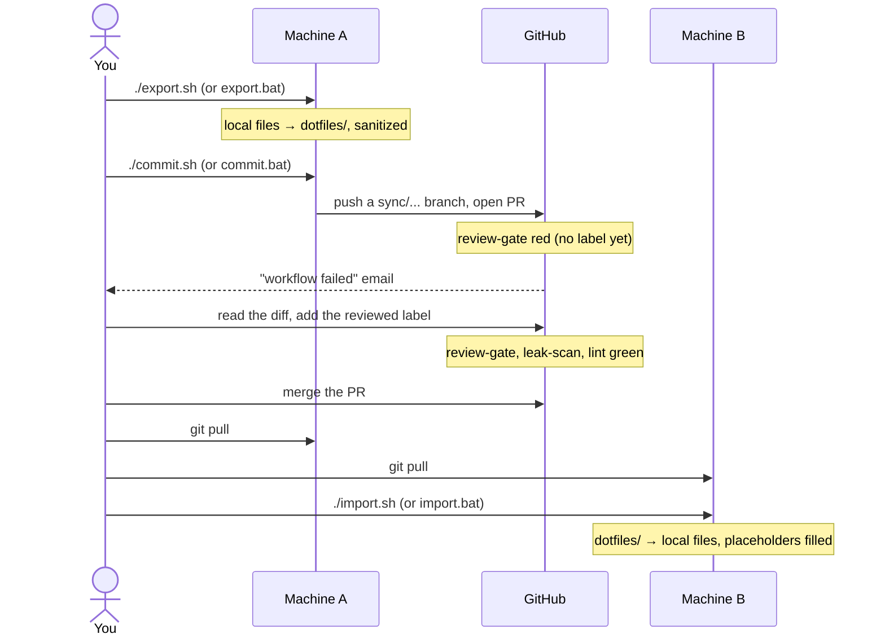

# Daily workflow

How a settings change moves from one machine to the other. The commit step opens a pull request; nothing is
pushed to `master` directly. See [review-gate.md](review-gate.md) for what the checks do.



## On the machine where you changed something

Start on an up-to-date `master` with no unrelated changes:

```bash
git switch master
git pull
```

See what would be sent. This changes nothing, in the repo or on the machine:

```bash
./sync preview
```

It lists each file's status, shows the full diff against `HEAD`, and runs the leak scan. The diff shows placeholders,
not your real values. If the scan finds something, the diff is left out; fix the file and preview again.

When it looks right, copy your settings into the repo and open the PR (add `-m "<message>"` to set the title yourself):

```bash
./sync export
./sync commit
```

`commit` creates the branch `sync/linux-<alias>-<yyyymmdd-hhmm>`, commits `dotfiles/` and `sync-config.json`,
pushes the branch, opens the PR and switches back to `master`. It prints the PR link.

On Windows, the commands are the same: `.\sync preview` in PowerShell, or `sync preview` in cmd. Use
`-Message "<message>"` to set the title. The branch is `sync/windows-<alias>-<yyyyMMdd-HHmm>`.

`./export.sh`, `./commit.sh`, `export.bat` and `commit.bat` still work.

### Machine alias

`<alias>` names this machine in branch names and PR bodies, so the hostname never appears there. The first
time you commit from a clone, `commit.sh` (or `commit.bat`) asks for it:

```
  Machine alias for branch names (e.g. laptop, desktop):
```

Use lowercase letters, digits and dashes (up to 24 characters, not starting with a dash). The alias is saved
in this clone's git config, is never committed, and is reused from then on. To see or change it:

```bash
git config --get syncsettings.machine
git config syncsettings.machine desktop
```

## Review and merge

Open the PR link. `review-gate` is red until you review it:

1. Read the diff. Go through the checklist in the PR description.
2. Add the `reviewed` label.
3. When all three checks are green, merge.

Then update `master` on this machine:

```bash
git pull
```

## On the other machine

```bash
git switch master
git pull
./sync import
```

Import asks before overwriting each file, and it always saves the old file as `<file>.bak` first, even with
`--force`. If you import a newer change over the same file later, that `.bak` is replaced. Import never deletes a local
file: one the repo doesn't have is reported as `EXTRA` and kept.

## Moving a machine to the new layout

The re-layout moved every file under `dotfiles/<platform>/<tool>/` and split `.gitconfig` into a shared file and a
`.gitconfig.local` per system ([layout.md](layout.md)). A machine that hasn't caught up still has the whole `.gitconfig`,
so **import first, then export**. Do this once on each machine, before any export:

```bash
git switch master
git pull
./sync import
```

Import asks for any value it doesn't have cached, so run it in a terminal. It rewrites `~/.gitconfig`, keeps the old
file as `~/.gitconfig.bak` and creates `~/.gitconfig.local`. Then check that git still works, and that the repo and the
machine agree:

```bash
git config --global user.email
git config --global --includes --get-all credential.https://github.com.helper
git ls-remote origin HEAD
./sync preview
```

The second command prints the `gh` line. `./sync preview` is safe at any time, and until you import it shows `.gitconfig`
as changed.

If you exported first, nothing is lost as long as you don't commit it. Drop the export, then import:

```bash
git restore dotfiles
./sync import
```

On Windows, the export copies the whole `.gitconfig`, credentials included, into the shared file, and `commit` stops at
the cached-value check. On Linux, the export deletes lines from the shared file instead, and `commit` doesn't stop, so
don't rely on it: read the diff.

## When `commit.sh` stops

| Message | What to do |
|---|---|
| `no machine alias set. Run: git config syncsettings.machine <alias>` | It ran without a terminal, so it could not ask. Run that command with your alias (e.g. `laptop`), then run it again |
| `invalid machine alias '<value>' …` | Pick an alias with only `a-z`, `0-9` and `-`, not starting with `-`. If the message ends with `in git config syncsettings.machine`, fix it with `git config syncsettings.machine <alias>` |
| `commit or stash changes outside dotfiles/ first.` | Commit those files on their own branch, or `git stash`, then run it again |
| `the leak scan found the lines above; nothing was committed.` | Open each `<file>:<line>` it listed, replace the personal text or add a `sanitizeRules` entry, export again, then run it again |
| `leak scan could not run; nothing was committed.` | Restore `scripts/ci/leak-scan.sh` with `git restore`. On Windows, make sure Git for Windows and its `bash.exe` are installed. Then run it again |
| `a cached value for <PLACEHOLDER> is in <file>; nothing was committed.` | Add a `sanitizeRules` entry for that placeholder to the file's entry, or remove the value from the file, export again, then run it again |
| `could not search for cached values; nothing was committed.` | A changed file could not be read. On Windows this can be a file name with unusual characters: rename it, then run it again |
| `sync-config.json: entry <repoPath> has an unsafe path.` | Fix that entry: `repoPath` starts with `dotfiles/`, `localPath` starts with `~/` or `~\`, and neither has a `..` segment. Remove any symlink under `dotfiles/` |
| `sync-config.json: entry <repoPath> has an invalid defaultEnv.` | Use a valid variable name: letters, digits and `_`, not starting with a digit |
| `run commit.sh from master (current: <branch>).` (or `commit.bat`) | `git switch master`, then run it again |
| `master is behind origin; pull first.` | `git pull`, then run it again |
| `local master has unpushed commits; push or move them to a branch first.` | `git branch <name>` to keep them on a branch, then `git reset --keep origin/master` (your uncommitted dotfiles changes stay) |
| `push failed; you are on <branch>.` | Fix the cause (network, auth), run the `git push -u origin <branch>` it prints, then `git switch master` |
| `PR creation failed; branch <branch> is pushed.` | Run the `gh pr create --base master --head <branch>` it prints, then `git switch master` |
| `gh is not found in PATH.` | Install the [GitHub CLI](https://cli.github.com/), then run `gh auth login` |

## Cleaning up

GitHub deletes the remote branch when the PR is merged. To drop the local copies:

```bash
git fetch --prune
git branch --list 'sync/*'
git branch -D <branch>
```
