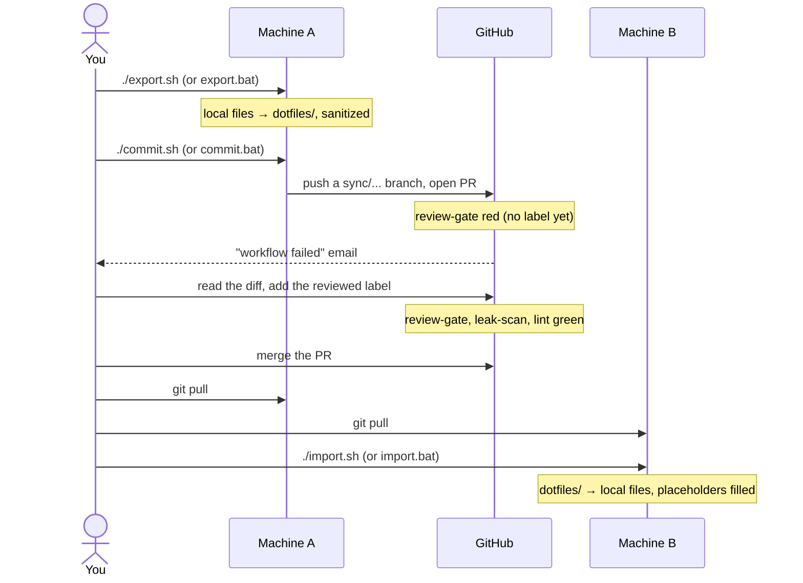

# Daily workflow

How a settings change moves from one machine to the other. The commit step opens a pull request; nothing is
pushed to `master` directly. See [review-gate.md](review-gate.md) for what the checks do.



## The short version

Linux, macOS and Windows run the same commands:

```bash
mksync        # where this machine stands, and what to run next
mksync push   # on the machine you changed: export, show, open the PR
mksync pull   # on the other machine, after the merge: pull, show, apply
```

`mksync` names the next command, so you don't have to remember the order. The rest of this page is the same flow step by
step, with the single scripts underneath. If `mksync` stops with something you don't recognize, see
[Troubleshooting `mksync`](#troubleshooting-mksync).

## Before you pull or push

Three dry runs show what would happen, and none of them writes anything:

```bash
mksync diff      # both ways: which side changed each file since this machine last synced
mksync check     # repo → this machine: every file an import would create or overwrite
mksync preview   # this machine → repo: the diff a push would send
```

The check compares this clone with the machine and doesn't fetch. If `mksync` shows `Origin : <n> update(s) waiting`,
a pull brings those too, and its own list (shown before it asks) is the one to read.

The check can't tell which side is newer; the diff can. It fetches first, then gives each differing file one label:

| Label | Meaning | Next |
|---|---|---|
| `IN` | Only the repo changed it | `mksync pull` takes it |
| `OUT` | Only this machine changed it | `mksync push` sends it |
| `BOTH` | Both changed it, differently | Merge by hand, then push |
| `?` | This machine has no sync recorded yet | Decide by hand; the next pull or push records one |

Each machine remembers the repo commit it last agreed with (`~/.local/state/sync-settings/last-sync`, or
`%LOCALAPPDATA%\SyncSettings\last-sync` on Windows). A full pull records it, and so does a push once its PR opens. Files
you pushed read `OUT` until the PR merges, then drop out of the list.

`mksync pull` runs the diff before it applies anything and stops if a file is `OUT` or `BOTH`, so it can't replace an
edit you haven't sent. Run `mksync push` first, or `mksync pull --force` to overwrite anyway (each file keeps its
`.bak`, and a dated copy: see [Getting an old version back](#getting-an-old-version-back)).

The first pull on a machine has no sync recorded, so it can't tell which side changed a file. It warns, and asks
`Apply these changes? [y/N]`: Enter keeps your files, `y` applies the repo's. `mksync pull --yes` refuses outright,
so a script never overwrites a machine it knows nothing about. Take files one at a time instead (below), or
`mksync pull --force`. A pull that finds nothing to change records the sync anyway, so the next diff has labels.
`mksync setup` and the restore script still take the repo's files on a new machine without asking.

## Take or send only some files

`mksync pull`, `mksync push` and `mksync diff` take paths, so you can move one file and leave the rest:

```bash
mksync diff                          # see which files differ, and which side changed them
mksync pull ~/.bashrc                # take the repo's version of this file only
mksync push dotfiles/common/git/.gitconfig   # send this file only
```

A path is either where the file lives on this machine (`~/.bashrc`, or relative to the folder you're in) or its path in
the repo (`dotfiles/...`). A folder entry takes a file inside it too. A path no entry syncs on this machine stops the
command before anything changes. The pull guard still checks the picked files: an `OUT` or `BOTH` file needs `--force`.

A pull or push of some files doesn't record a sync point, since the machine only agrees with part of the repo. Run a
plain `mksync pull` or `mksync push` when you want the labels to start from there.

## Getting an old version back

Every file a pull overwrites keeps two copies of the old version: `<file>.bak` next to it, replaced by the next pull of
the same file, and a dated copy that stays for the last 20 pulls:

- Linux and macOS: `~/.local/state/sync-settings/backups/<run>/<repo path>` (under `$XDG_STATE_HOME` when it's set)
- Windows: `%LOCALAPPDATA%\SyncSettings\backups\<run>\<repo path>`

`<run>` is the date and time of the pull, so the newest folder sorts last, and the pull prints it as `Backups : <folder>`.
To restore a file, copy it back over the current one:

```bash
cp ~/.local/state/sync-settings/backups/20261109-153000-4242/dotfiles/common/git/.gitconfig ~/.gitconfig
```

## On the machine where you changed something

Start on an up-to-date `master` with no unrelated changes:

```bash
git switch master
git pull
```

See what would be sent. This changes nothing, in the repo or on the machine:

```bash
./sync preview
```

It lists each file's status, shows the full diff against `HEAD`, and runs the leak scan. The diff shows placeholders,
not your real values. If the scan finds something, the diff is left out; fix the file and preview again.

When it looks right, copy your settings into the repo and open the PR (add `-m "<message>"` to set the title yourself):

```bash
./sync export
./sync commit
```

`commit` creates the branch `sync/linux-<alias>-<yyyymmdd-hhmm>` (`sync/macos-<alias>-<yyyymmdd-hhmm>` on a Mac),
commits `dotfiles/`, `packages/` and `sync-config.json`, pushes the branch, opens the PR and switches back to
`master`. It prints the PR link.

On Windows, the commands are the same: `.\sync preview` in PowerShell, or `sync preview` in cmd. Use
`-Message "<message>"` to set the title. The branch is `sync/windows-<alias>-<yyyyMMdd-HHmm>`.

`./export.sh`, `./commit.sh`, `export.bat` and `commit.bat` still work.

### Changes you didn't make

Some tools rewrite their own settings, so preview can show a file you never opened:

| File | Rewritten by |
|---|---|
| `dotfiles/common/htop/htoprc` | htop, when you change a setting in its interface |
| `dotfiles/linux/gnome/mimeapps.list` | The desktop, when a default app changes |
| `dotfiles/common/vscode/settings.json` | VS Code Settings Sync, with changes from your other machine |
| `dotfiles/linux/gnome/dconf/*.ini` | The desktop, when you change the theme, pin an app or change a shortcut |

These are real settings, so read the diff rather than reverting it. To keep one out of a PR, run `git restore <file>`
after the export; preview keeps showing it until you send it.

### A `DRIFT` line

On Linux, preview and export end by comparing `packages/linux/` with the machine. A line like this after you install
something is normal:

```text
  DRIFT      apt/cowsay  (installed, not in packages/linux/apt.txt)
```

It's only a report: nothing was changed, and it doesn't stop anything. If you want the package on a restored machine, add it to
the list, run `scripts/ci/check-packages.sh`, then `./sync commit`. If not, uninstall it or add it to `drift-ignore.txt`.
[packages.md](packages.md#reading-the-report) covers every note.

### Machine alias

`<alias>` names this machine in branch names and PR bodies, so the hostname never appears there. The first
time you commit from a clone, `commit.sh` (or `commit.bat`) asks for it:

```
  Machine alias for branch names (e.g. laptop, desktop):
```

Use lowercase letters, digits and dashes (up to 24 characters, not starting with a dash). The alias is saved
in this clone's git config, is never committed, and is reused from then on. To see or change it:

```bash
git config --get syncsettings.machine
git config syncsettings.machine desktop
```

## Review and merge

Open the PR link. `review-gate` is red until you review it:

1. Read the diff. Go through the checklist in the PR description.
2. Add the `reviewed` label.
3. When all four checks are green, merge.

Then update `master` on this machine:

```bash
git pull
```

## On the other machine

```bash
git switch master
git pull
./sync import
```

`mksync pull` does all three, and shows what will change before asking. `mksync check` shows the same list without
applying it.

Import asks before overwriting each file, and it always saves the old file as `<file>.bak` first, even with
`--force`. If you import a newer change over the same file later, that `.bak` is replaced. Import never deletes a local
file: one the repo doesn't have is reported as `EXTRA` and kept.

On Linux, run it in a terminal on the desktop, because GNOME settings load over the session bus. Their backups go in
`~/.local/state/sync-settings/dconf/`, and a setting the repo doesn't name stays as it is.

### Another user on the same Windows machine

`import.bat -User <name>` applies the repo to that user's profile (`C:\Users\<name>`) instead of yours. When it isn't
the user you're signed in as, the script asks Windows for an administrator window itself (the UAC prompt), so you don't
need to start it elevated. Linux and macOS have no `-User`: run the import as that user.

## Moving a machine to the new layout

The re-layout moved every file under `dotfiles/<platform>/<tool>/` and split `.gitconfig` into a shared file and a
`.gitconfig.local` per system ([layout.md](layout.md)). A machine that hasn't caught up still has the whole `.gitconfig`,
so **import first, then export**. Do this once on each machine, before any export:

```bash
git switch master
git pull
./sync import
```

Import asks for any value it doesn't have cached, so run it in a terminal. It rewrites `~/.gitconfig`, keeps the old
file as `~/.gitconfig.bak` and creates `~/.gitconfig.local`. Then check that git still works, and that the repo and the
machine agree:

```bash
git config --global user.email
git config --global --includes --get-all credential.https://github.com.helper
git ls-remote origin HEAD
./sync preview
```

The second command prints the `gh` line. `./sync preview` is safe at any time, and until you import it shows `.gitconfig`
as changed.

If you exported first, nothing is lost as long as you don't commit it. Drop the export, then import:

```bash
git restore dotfiles
./sync import
```

On Windows, the export copies the whole `.gitconfig`, credentials included, into the shared file, and `commit` stops at
the cached-value check. On Linux, the export deletes lines from the shared file instead, and `commit` doesn't stop, so
don't rely on it: read the diff.

## When `commit.sh` stops

| Message | What to do |
|---|---|
| `no machine alias set. Run: git config syncsettings.machine <alias>` | It ran without a terminal, so it could not ask. Run that command with your alias (e.g. `laptop`), then run it again |
| `invalid machine alias '<value>' …` | Pick an alias with only `a-z`, `0-9` and `-`, not starting with `-`. If the message ends with `in git config syncsettings.machine`, fix it with `git config syncsettings.machine <alias>` |
| `commit or stash changes outside dotfiles/ first.` | Commit those files on their own branch, or `git stash`, then run it again |
| `the leak scan found the lines above; nothing was committed.` | Open each `<file>:<line>` it listed, replace the personal text or add a `sanitizeRules` entry, export again, then run it again |
| `leak scan could not run; nothing was committed.` | Restore `scripts/ci/leak-scan.sh` with `git restore`. On Windows, make sure Git for Windows and its `bash.exe` are installed. Then run it again |
| `a cached value for <PLACEHOLDER> is in <file>; nothing was committed.` | Add a `sanitizeRules` entry for that placeholder to the file's entry, or remove the value from the file, export again, then run it again |
| `could not search for cached values; nothing was committed.` | A changed file could not be read. On Windows this can be a file name with unusual characters: rename it, then run it again |
| `sync-config.json: entry <repoPath> has an unsafe path.` | Fix that entry: `repoPath` starts with `dotfiles/`, `localPath` starts with `~/` or `~\`, and neither has a `..` segment. Remove any symlink under `dotfiles/` |
| `sync-config.json: entry <repoPath> needs "platform": "linux" and a dconf path like /org/gnome/shell/.` | Fix that dconf entry: `"platform": "linux"`, and a `path` that starts and ends with `/` |
| `sync-config.json: entry <repoPath> has an invalid defaultEnv.` | Use a valid variable name: letters, digits and `_`, not starting with a digit |
| `run commit.sh from master (current: <branch>).` (or `commit.bat`) | `git switch master`, then run it again |
| `master is behind origin; pull first.` | `git pull`, then run it again |
| `local master has unpushed commits; push or move them to a branch first.` | `git branch <name>` to keep them on a branch, then `git reset --keep origin/master` (your uncommitted dotfiles changes stay) |
| `push failed; you are on <branch>.` | Fix the cause (network, auth), run the `git push -u origin <branch>` it prints, then `git switch master` |
| `PR creation failed; branch <branch> is pushed.` | Run the `gh pr create --base master --head <branch>` it prints, then `git switch master` |
| `gh is not found in PATH.` | Install the [GitHub CLI](https://cli.github.com/), then run `gh auth login` |

## Troubleshooting `mksync`

| What you see | What to do |
|---|---|
| Windows: `running scripts is disabled on this system` | You don't need to change the execution policy: `mksync`, `sync.cmd` and the `.bat` files start PowerShell with `-ExecutionPolicy Bypass`, and the installer runs through `iex`. Start from those, not by running a `.ps1` directly |
| Windows: the installer prints `ERROR: install Git from https://git-scm.com, …` | There's no `winget` on this machine (it comes with App Installer from the Microsoft Store). Install Git from that link, open a new window, and run the installer again. `gh` can come later; `doctor` says how |
| `mksync` is not recognized, or `command not found` | The window was open before the install changed `PATH`. Open a new one. On Windows, if a new window still can't find it, run the installer again; on Linux, `doctor` prints the `ln -s` line that links it |
| macOS: `ERROR: SyncSettings needs bash 4 or newer (this is 3.2.57…)` | macOS's own bash is too old. Run `brew install bash`; after that the scripts switch to Homebrew's bash by themselves. More in [Restore: macOS](restore.md#troubleshooting-on-macos) |
| `Next: the machine check failed; run ./import.sh --check to see why.` | The status couldn't compare the repo with this machine. Run the command it names and read its `ERROR` lines |
| `WARN gh: not signed in; run gh auth login` | Run `gh auth login` once. Only `mksync push` needs it, to open the pull request |
| `SKIPPED … needs values: run mksync setup` | A file has a placeholder (your name, email, a path) with no value yet. Run `mksync setup`; it asks for each one and saves it in `.user-values.json`, which never leaves the machine |
| `WARN <n> value(s) not set; mksync setup asks for them` | The same thing, seen from `doctor` |
| `./import.sh --check` (or `Import-Settings.ps1 -Check`) exits with 3 | Not an error: it means `<n> file(s) would change`. Read the list. If you changed any of those files on this machine, run `mksync push` first; otherwise `mksync pull` applies it. Exit 0 means the machine matches, and exit 1 means a check couldn't run (see its `ERROR` lines) |
| `ERROR: <n> file(s) changed on this machine since the last sync, and a pull would overwrite them.` | The pull found `OUT` or `BOTH` files (listed above the error). Run `mksync push` to send them, or `mksync pull --force` to replace them with the repo's version (each keeps a `.bak`) |
| `ERROR: could not tell which side is newer; …` | The diff couldn't run. Run `mksync diff` and read its `ERROR` line; `mksync pull --force` skips the diff |
| `ERROR: the repo has changes not sent yet; run mksync push first, …` | `pull` won't mix your unsent changes with the repo's. Send them with `mksync push`, or drop them with `git restore`, then pull |
| `ERROR: <dir> exists and isn't a SyncSettings clone; set SYNCSETTINGS_DIR.` | The installer won't write into a folder it didn't make. Move that folder, or set `SYNCSETTINGS_DIR` to another place and run it again |
| Windows: `ERROR: …\mksync.cmd already exists; remove it and run this again.` | Another `mksync.cmd` is in the installer's bin folder. Remove or rename it if it isn't yours to keep, then run the installer again |

## Cleaning up

GitHub deletes the remote branch when the PR is merged. To drop the local copies:

```bash
git fetch --prune
git branch --list 'sync/*'
git branch -D <branch>
```
