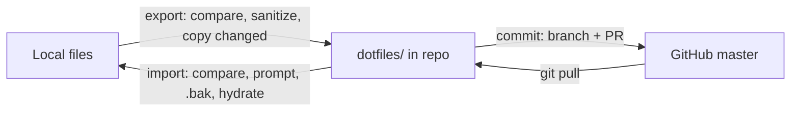

# Sync engine contract

SyncSettings has two engines: PowerShell 5.1 on Windows (`scripts/windows/`) and bash on Linux
(`scripts/linux/sync.sh` plus `export.sh`, `import.sh`, `commit.sh`). They share no code. They share
`sync-config.json`, the `.user-values.json` format, and the rules on this page.

This page is for contributors. If you change how an engine behaves, change this page in the same PR, and add a
fixture case to `tests/linux/engine.sh` or `tests/windows/Engine.Tests.ps1` (or both) that proves the rule. A rule
listed under [Known differences](#known-differences) applies to one engine only. Every other rule applies to both.

To add or change an entry in `sync-config.json`, see [configuration.md](configuration.md).

## Flow



- **Export** reads every selected entry's local file. It compares the file with the repo copy by content (never by
  date), sanitizes it, and writes only the files that changed.
- **Commit** runs the [checks before pushing](#checks-before-pushing), stages `dotfiles/`, `sync-config.json` and
  `packages/` (if it exists), commits on a `sync/<os>-<machine>-…` branch and opens a PR. It never pushes to `master`. See
  [review-gate.md](review-gate.md).
- **Import** reads every selected entry's repo file and hydrates its placeholders. If the local file differs, import
  asks before overwriting it (unless forced) and keeps a `.bak` copy of the old file.

## Entry selection

Each entry in `files` has a required `platform`:

| `platform` | Windows engine | bash engine |
|---|---|---|
| `windows` | yes | no |
| `linux` | no | yes |
| `common` | yes | yes |

If any entry has no `platform`, or a value outside these three, the engine stops with exit code 1 before it touches a
file:

```text
ERROR: sync-config.json: entry <repoPath> needs "platform": "common", "windows" or "linux".
```

The check covers every entry, not only the ones the engine would select, so a bad Linux entry also stops the Windows
engine. CI lint catches the same mistake earlier.

Entries run in the order they appear in `sync-config.json`.

## Path safety

Right after the `platform` check, each engine checks every entry, on any platform, and stops with exit code 1 before it
touches a file:

- `repoPath` starts with `dotfiles/` and has no `..` segment.
- `localPath` starts with `~/` or `~\` and has no `..` segment.
- Nothing under `dotfiles/` is a symlink.

```text
ERROR: sync-config.json: entry <repoPath> has an unsafe path.
```

The bash engine also checks that `defaultEnv` matches `^[A-Za-z_][A-Za-z0-9_]*$`, because it uses the name to look up a
variable. PowerShell reads the name as plain data, so it has no such check.

```text
ERROR: sync-config.json: entry <repoPath> has an invalid defaultEnv.
```

## `localPath`

| Form | Example | Works on |
|---|---|---|
| `~/` + forward slashes | `~/.config/git/ignore` | both. PowerShell turns `/` into `\` after expanding `~` |
| `~\` + backslashes | `~\.gitconfig` | Windows only |

`~` is the user's home: `$HOME` on Linux, the profile folder on Windows (`$env:USERPROFILE`, or the target user's
profile with `-User`). A `common` entry must use the `~/` form. Every `localPath` must use one of these two forms: an
absolute path stops the run ([Path safety](#path-safety)).

## Statuses

Each file gets one status line: the status word, its label (the `repoPath`, or `<repoPath>/<rel>` inside a
directory entry) and sometimes a note in parentheses. The layout is up to each engine (PowerShell puts the word in
brackets and colors it), but the word, the label and the notes listed below are the contract, and tests match on
them.

### Export

| Case | Status | Note |
|---|---|---|
| Local path matches an exclude pattern | `SKIPPED` | `matches exclude pattern` |
| Local file missing | `SKIPPED` | `local file not found: <path>` |
| Repo file missing | `ADDED` | `sanitized` if the entry has rules |
| Same content | `UNCHANGED` | |
| Different content | `MODIFIED` | `sanitized` if the entry has rules |
| `type: dir`: repo file no longer present locally | `REMOVED` | `no longer in source` |
| Read, write or copy failed | `ERROR` | the reason |

### Import

| Case | Status | Note |
|---|---|---|
| Local path matches an exclude pattern | `SKIPPED` | `matches exclude pattern` |
| Repo file missing | `SKIPPED` | `not found in repo` |
| Local file missing | `CREATED` | |
| Same content | `UNCHANGED` | |
| Different content, overwrite accepted | `UPDATED` | `backup saved as <name>.bak` |
| Different content, user answered no | `SKIPPED` | `user skipped` |
| `type: dir` or linked folder: local file not in the repo | `EXTRA` | `not in repo; kept` |
| Read, write or copy failed | `ERROR` | the reason |

### Both

| Case | Status | Note |
|---|---|---|
| File under `dotfiles/` that no entry owns | `ORPHAN` | `no entry in sync-config.json; git rm it or add an entry` |

An `ERROR` affects only its own file. The engine moves on to the next entry, and the run still exits 0. Exit code 1
is reserved for problems that stop the whole run: invalid config, a missing placeholder value, a failed `git pull`, or a
failed [check before pushing](#checks-before-pushing).

## Overwrite prompt

Unless `--force` (bash) or `-Force` (PowerShell) is given, import asks `Overwrite <file>? [Y/n]` before it replaces a
local file whose content differs. An empty answer means yes. In bash, end of input (for example `< /dev/null`) also
counts as an empty answer, so a non-interactive run without `--force` overwrites. The `.bak` copy is still written.
Force skips only the prompt, never the `.bak`.

## Sanitize and hydrate

`sanitizeRules` hold the placeholders for one entry's file. On export, sanitizing replaces real values with
placeholders. On import, hydrating puts the values back.

**Where values come from**, in this order:

1. `.user-values.json` next to `sync-config.json` (gitignored, keys are placeholders).
2. Import only: values inferred from the existing local file (below). They are never used for a placeholder that
   already has a cached value.
3. A prompt, offering a default taken from the first of these that exists: the cached value, the rule's `default`,
   the environment variable named by `defaultEnv`. An empty answer takes the default. With no default it stops the run
   (see below).

`--reset-values` (bash) or `-ResetValues` (PowerShell) prompts again for every placeholder and skips inference.
New values are saved back to `.user-values.json`. Each save leaves the file readable by the current user only: mode 600
on Linux, also tightening an existing file, and no inherited access on Windows.

**Inference on import.** For each entry with rules whose local and repo files both exist, the engine compares the
two files line by line, up to the shorter one, with `\r` stripped. Take a repo line that contains a placeholder,
paired with a local line that doesn't. If the local line starts with the text before the placeholder and ends with
the text after it, the text in between is the value. Empty results are ignored. For a rule with
`escapeBackslashes: true`, each `\\` in the inferred value becomes `\`, because the file holds the doubled form.

**Sanitize (export).** Values are replaced longest first, so a value that contains a shorter one is replaced whole.
For each value that contains `\`, its backslash-doubled form (`C:\\Tools`) is replaced before the plain form
(`C:\Tools`), so files that escape backslashes sanitize too.

**Hydrate (import).** Each placeholder gets its value. If the rule has `escapeBackslashes: true` and the value
contains `\`, the placeholder gets the backslash-doubled value instead.

**Missing value.** If a placeholder has no value after all of the above, with or without a terminal, the engine prints
`missing value for <PLACEHOLDER>: add it to .user-values.json` and exits 1 before writing any file. Output names the
placeholder, never its value.

## Compare

- Files without rules: byte for byte (`cmp` in bash, SHA256 in PowerShell).
- Files with rules: the sanitized local text (export) or the hydrated repo text (import) against the other side,
  after turning CRLF into LF and trimming whitespace at the end of the file. A file that differs only in line
  endings or trailing blank lines counts as `UNCHANGED`, and nothing is written. The compare is case-sensitive, so a
  change of case counts as `MODIFIED`.

Text is written byte for byte: no BOM, and trailing newlines are kept.

## Backups

Import copies the old local file to `<file>.bak` before overwriting it, replacing any older `.bak`, in every entry type.
`*.bak` is in `excludePatterns`, so a `.bak` inside a synced directory is never exported.

## Exclude patterns

`excludePatterns` are globs matched against the local path's file name, or the end of the path. A match is skipped
on export and import, and inside directory entries too.

## Directory entries (`type: dir`)

An entry with `"type": "dir"` syncs a whole folder, recursively.

- Only regular files are synced. Symlinks are `SKIPPED` with the note `symlink`. A symlink at the folder's own
  path is followed.
- `excludePatterns` apply to every file. `sanitizeRules` and `detectLinkedPaths` are not allowed on a `dir`
  entry (lint fails).
- If the local folder is missing on export, the entry is `SKIPPED` with the note `local folder not found: <path>`.
- If no local file passes the symlink and exclude checks (an empty folder, or one holding only symlinks or excluded
  files) while the repo folder still holds at least one file, the entry is `SKIPPED` with the note
  `local folder is empty; repo files kept` and no repo file is removed.
- Export deletes repo files that are gone locally or are now excluded (`REMOVED`; git keeps the history), then
  removes empty folders under the entry's `repoPath`.
- Import never deletes. A local file that the repo doesn't have is reported as `EXTRA` and kept, so a file you
  haven't exported yet survives an import.
- Each file inside follows the same compare, prompt and `.bak` rules as a plain entry.

## Linked folders (`detectLinkedPaths`)

PowerShell only. A folder detected in an entry's file is stored under `<repoPath>.linked/<folder>/`.

- Export deletes repo files that are gone from the folder, like a `dir` entry.
- An empty folder keeps its repo files, like a `dir` entry.
- Import never deletes. A local file that the repo doesn't have is reported as `EXTRA` and kept.
- Each file inside follows the same compare, prompt and `.bak` rules as a plain entry on import, and `excludePatterns`
  apply to it.

## Checks before pushing

Commit runs these after the check for changes outside the sync paths, and before it creates a branch or a commit. A
failure exits 1 and leaves no branch, no commit and no PR.

**Leak scan.** `scripts/ci/leak-scan.sh` runs on the sync paths. Skipping it is not an option: a scan that cannot run stops
the commit the same way a hit does.

| Scan result | Message |
|---|---|
| Exit 1 | `ERROR: the leak scan found the lines above; nothing was committed.` |
| Script or bash missing, or any other exit code | `ERROR: leak scan could not run; nothing was committed.` |

**Cached values.** The changed sync files are searched for each value in `.user-values.json`, ignoring case and including
the backslash-doubled form. A placeholder on its own passes. The value never appears in arguments or output.

```text
ERROR: a cached value for <PLACEHOLDER> is in <file>; nothing was committed.
```

A search that cannot finish stops the commit too, with `ERROR: could not search for cached values; nothing was committed.`

## Orphan report

At the end of an export, each engine lists every file under `dotfiles/` that no entry owns, as `ORPHAN`. A file is
owned if it is an entry's `repoPath`, lies under a `dir` entry's `repoPath/`, or lies under `<repoPath>.linked/` of
an entry with `detectLinkedPaths`. Entries for all platforms count, so both engines print the same list. The report
never deletes anything, and never changes the change count or the exit code.

## Up-to-date check

Export and import start by checking whether the repo is behind `origin/master`:

- Not a git repo, no `origin` remote, or a branch other than `master`: no check, no message.
- `git fetch` fails: `NOTE: could not reach origin; skipping the up-to-date check.` and the run continues.
- Up to date: no message.
- Behind, with a terminal: `Repo is <n> commit(s) behind origin/master. Pull now (git pull --ff-only)? [Y/n]`. Yes
  pulls, prints `Pulled <n> commit(s); run the command again.` and exits 0, so the next run uses the
  pulled config and scripts. If the pull fails: `ERROR: pull failed; resolve it and rerun.` and exit 1.
  No continues without pulling.
- Behind, without a terminal: `WARNING: repo is <n> commit(s) behind origin/master; run git pull --ff-only.` and the
  run continues.

## Export preview

`--preview` (bash) or `-Preview` (PowerShell) shows exactly what a commit would send, and writes nothing to the repo or
the machine.

- The engine copies `dotfiles/`, `sync-config.json`, `.user-values.json` and itself to a temp folder, runs a normal
  export there, and compares the result with `HEAD`. Changes exported earlier but not yet committed therefore show too.
- Status lines are the same as in a real export, followed by a `--stat` summary and the full diff. Text is sanitized,
  so the diff holds placeholders, not real values.
- The temp folder is removed at the end, also after a failure. A placeholder value answered during a preview is not
  saved.
- The leak scan runs on the result before any diff prints. A hit prints `WARNING: the leak scan found the lines above.
  Fix them before committing.`, leaves the diff out so the leaked text stays off the screen, and the preview exits 1.
  A scan that cannot run prints `ERROR: leak scan could not run; nothing was committed.`, prints no diff and exits 1.
- With no differences: `Nothing would be sent: the repo matches HEAD.`
- `--preview` with `--reset-values` is an error, and a preview outside a git repo with a commit is an error. Both exit 1.
- The up-to-date check does not run.
- A preview ends with `Nothing was written. Run ./export.sh to apply.` (`export.bat` on Windows).

## One command

`./sync <preview|export|commit|import> [options]` on Linux and Git Bash, `.\sync` in PowerShell, `sync` in cmd. The name
resolves to the right script for the OS, so `sync` and `sync.cmd` are the two front doors, and Git Bash on Windows hands
over to `sync.cmd`. Options pass through unchanged. The `.sh` and `.bat` entry points still work.

With no command, `sync` prints the usage and the detected OS and exits 0. An unknown command, or a missing `git`, `jq`
or `gh` on Linux, exits 1 and names what's wrong.

## Known differences

| Behavior | Windows (PowerShell) | Linux (bash) |
|---|---|---|
| Export, local file missing | the note starts with `WARNING:`, and is `WARNING: folder not found: <dir>` if its folder is missing too | the note in the [Export](#export) table |
| Import, target folder missing | `SKIPPED` with `WARNING: target folder not found: <dir>`; the app is probably not installed. For a `dir` entry this checks the folder's parent | creates the folder (`mkdir -p`) |
| Exclude patterns | case-insensitive (`-like`) | case-sensitive |
| End of input at the overwrite prompt | depends on the host; run with `-Force` | counts as yes |
| `detectLinkedPaths` | supported | not supported |
| `-User <name>` (import into another profile, elevated) | supported | not supported |
| File modes | not kept | kept (`cp -p`; mode copied for written text) |
| Status line layout | `[WORD      ] label`, colored | `WORD       label` |
| Sanitized text that isn't valid UTF-8 | invalid bytes are replaced when read | bytes are kept |
| `defaultEnv` name check | none needed | stops the run on an invalid name |

## Parity

Every gap listed in [plan-restructure.md](plan-restructure.md) is closed. A step number is the step of
[plan-restructure-2.md](plan-restructure-2.md) that closed the gap in that engine, and `yes` means the engine already
had the behavior.

| Behavior | Windows | Linux | Note |
|---|---|---|---|
| Required `platform` with `common` | step 6 | step 5 | lint: step 7 |
| `defaultEnv` | step 8 | yes | |
| `escapeBackslashes` | yes | step 9 | |
| Infer values from the local file on import | yes | step 10 | |
| Inference undoes `escapeBackslashes` | step 10b | step 10a | |
| `type: dir` export | step 13 | step 11 | |
| `type: dir` import | step 14 | step 12 | |
| Missing value without a terminal stops the run | step 8a | yes | |
| Missing target folder on import | | | kept as a known difference |
| Orphan report | step 16 | step 15 | |
| Up-to-date check | step 18 | step 17 | |
| Stop after a pull | step 18b | step 18a | |
| Commit: branch + PR, stages `dotfiles/ packages/ sync-config.json` | yes | yes | phase 1 |
